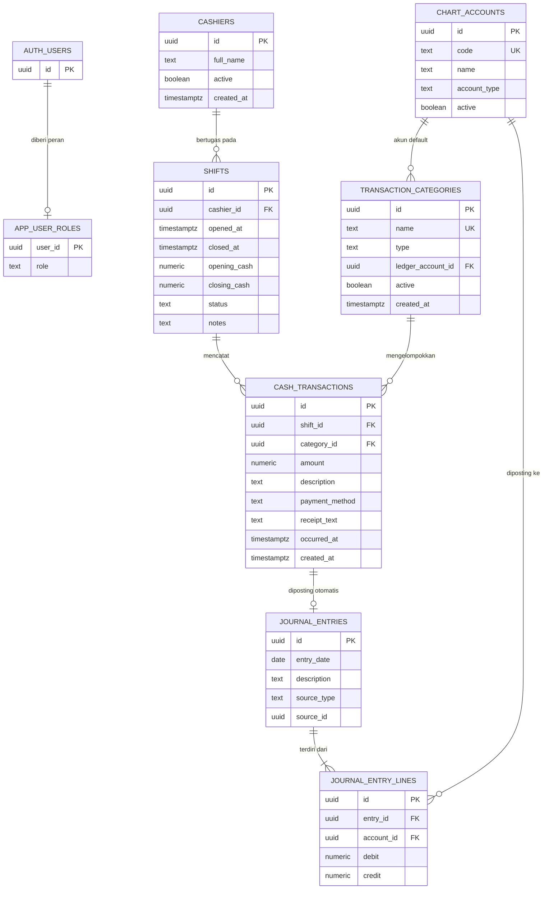

# Bas Station

🌐 **Demo aplikasi:** [Buka Bas Station](https://ebessebastian2018-web.github.io/gas-station-cash-app/)

> Aplikasi pencatatan transaksi dan pengelolaan arus kas operasional stasiun pengisian bahan bakar umum (SPBU).

## Identitas tugas

| Keterangan | Detail |
|---|---|
| Nama | Sebastian Widyajaya |
| NIM | 12030124140294 |
| Mata Kuliah | Pengkodean dan Pemograman |
| Kelas | D |
| Dosen Pengampu | Dr. Totok Dewayanto, S.E., M.Si., Akt. |

**Disusun untuk memenuhi Tugas Project UTS Pengkodean dan Pemograman.**

## Akun demo

Isi kolom berikut sendiri apabila sudah menyiapkan akun operator untuk demonstrasi.

| Username / email | Password |
|---|---|
| `[ISI SENDIRI]` | `[ISI SENDIRI]` |

> **Keamanan:** repository dan README GitHub dapat dilihat publik. Jangan masukkan password asli, service-role key, atau rahasia lain ke dokumen ini. Gunakan akun demo khusus dengan akses minimum, atau bagikan kredensial secara privat kepada dosen/penguji.

## Penjelasan sistem

Bas Station adalah aplikasi web untuk membantu pencatatan dan pemantauan kas operasional SPBU. Admin masuk untuk memulai atau menutup shift, sedangkan owner melihat ringkasan, transaksi, laporan, jurnal umum, dan buku besar. Data aplikasi disimpan di PostgreSQL melalui Supabase; aplikasi tidak mempunyai server backend terpisah.

Frontend statis berkomunikasi langsung dengan Supabase menggunakan Supabase JavaScript client. Pengguna yang belum masuk atau belum diberi peran akan diarahkan ke formulir login. Operasi baca dan tulis dibatasi berdasarkan peran melalui Row Level Security (RLS).

## Fitur

- **Ringkasan:** metrik pemasukan, pengeluaran, saldo tunai shift aktif, dan jumlah transaksi hari ini.
- **Transaksi:** pencatatan kas masuk dan keluar, pencarian, filter jenis transaksi, metode pembayaran, dan rincian struk berbasis teks. Owner dapat mencatat tanpa shift; transaksi tetap masuk ke laporan tetapi tidak memengaruhi saldo shift.
- **Penjualan BBM:** pilihan V1 (Rp10.000/liter), V2 (Rp15.000/liter), dan SX (Rp7.500/liter); jumlah transaksi dihitung otomatis dari jumlah liter.
- **Shift kasir:** admin memulai shift dengan kas awal, lalu dapat mencatat penjualan dan menutup shift dengan memasukkan jumlah kas fisik. Penjualan admin harus terkait dengan shift yang aktif.
- **Penjualan admin:** mencatat BBM dengan hitung liter otomatis, atau layanan SPBU seperti isi angin, tambal ban bocor, ganti ban, dan ganti oli dengan nominal yang dimasukkan.
- **Laporan:** grafik arus kas, komposisi kas, serta ringkasan pendapatan, beban, dan laba/rugi bersih berdasarkan jurnal untuk 7 atau 14 hari terakhir; tersedia akses cepat ke jurnal umum dan buku besar.
- **Jurnal umum:** transaksi kas menghasilkan jurnal debit-kredit otomatis; owner juga dapat mencatat jurnal manual yang seimbang.
- **Buku besar:** melihat mutasi dan saldo berjalan untuk setiap akun.
- **Hak akses:** admin dapat mengelola shift dan mencatat pemasukan/penjualan; owner tidak perlu mengelola shift dan dapat mencatat transaksi serta melihat ringkasan, laporan, jurnal, dan buku besar.
- **Autentikasi:** login dan logout akun yang dikelola melalui Supabase Authentication; peran ditetapkan manual oleh pengelola.
- **Tampilan responsif:** navigasi menu seluler dengan backdrop, kontrol ramah sentuhan, dan transaksi dalam bentuk kartu pada layar ponsel.

## Logika akuntansi dan perhitungan

1. Setiap transaksi dikaitkan dengan satu **kategori** bertipe `income` (pemasukan) atau `expense` (pengeluaran), dan dengan **shift** yang mencatat transaksi tersebut.
2. Nominal transaksi disimpan sebagai angka positif. Jenis kategori menentukan apakah nominal diperlakukan sebagai pemasukan atau pengeluaran; transaksi pengeluaran tidak disimpan sebagai nominal negatif.
3. Transaksi tunai memengaruhi metrik kas dan saldo shift. Transaksi transfer dan kartu/QRIS tetap dicatat pada riwayat, tetapi tidak dihitung sebagai perubahan kas fisik dalam metrik tersebut.
4. Ringkasan pemasukan dan pengeluaran hari ini menjumlahkan transaksi tunai bertanggal hari ini:
   - `Pemasukan tunai = jumlah transaksi tunai berkategori income`
   - `Pengeluaran tunai = jumlah transaksi tunai berkategori expense`
5. Saldo kas berjalan untuk shift aktif dihitung sebagai:
   - `Saldo berjalan = saldo kas awal + pemasukan tunai shift − pengeluaran tunai shift`
   - Jika tidak ada shift aktif, nilai saldo berjalan pada dashboard adalah Rp0.
6. Total penjualan BBM dihitung otomatis:
   - `Jumlah transaksi = harga per liter × jumlah liter`
   - Rincian jenis bensin, liter, harga satuan, dan total disimpan sebagai keterangan dan teks struk.
7. Saat shift ditutup, operator memasukkan kas fisik akhir. Nilai tersebut disimpan sebagai kas penutupan; aplikasi saat ini tidak otomatis menyimpan atau menghitung selisih kas.
8. Grafik laporan mengelompokkan transaksi tunai berdasarkan tanggal. Tanggal ringkasan dan agregasi grafik dihitung menggunakan tanggal UTC oleh aplikasi.

> Ringkasan ini merupakan pencatatan operasional kas, bukan pengganti buku besar, jurnal akuntansi lengkap, rekonsiliasi bank, atau laporan keuangan resmi.

### Jurnal dan buku besar

- Transaksi baru otomatis diposting ke jurnal berpasangan: pemasukan mendebit kas/bank dan mengkredit akun pendapatan; pengeluaran mendebit akun kategori dan mengkredit kas/bank.
- Metode tunai menggunakan akun **Kas Tunai**; transfer dan kartu/QRIS menggunakan **Bank / QRIS**.
- Kategori awal dipetakan ke akun persediaan, pendapatan, atau beban. Kategori tambahan yang belum dipetakan menggunakan akun pendapatan/beban lain-lain.
- Jurnal manual hanya dapat dibuat oleh owner dan harus memiliki minimal dua baris dengan total debit sama dengan kredit.
- Menjalankan schema akan membuat akun awal dan membentuk jurnal untuk transaksi lama yang belum mempunyai jurnal.
- Akun awal ditujukan untuk demonstrasi. Tinjau pemetaan dan perlakuan akuntansi agar sesuai kebijakan pembukuan usaha sebelum digunakan sebagai laporan resmi.

## ERD



Relasi utama: satu kasir dapat memiliki banyak shift, satu shift dapat mencatat banyak transaksi, dan satu kategori dapat digunakan oleh banyak transaksi. Penghapusan data yang masih direferensikan dibatasi dengan foreign key `ON DELETE RESTRICT`.

## Struktur folder

```text
.
├── .github/
│   └── workflows/
│       └── deploy-pages.yml   # Otomatisasi deployment GitHub Pages
├── backend/
│   ├── demo-data.sql          # Transaksi demo berlabel untuk mengisi laporan
│   └── schema.sql             # Tabel, indeks, RLS, dan data awal Supabase
├── frontend/
│   ├── images/                # Aset foto untuk tampilan aplikasi
│   ├── app.js                 # UI, autentikasi, dan integrasi Supabase
│   ├── index.html             # Halaman aplikasi
│   └── styles.css             # Tampilan dan layout responsif
├── index.html                 # Pengarah ke aplikasi di frontend/
├── .gitignore
└── README.md
```

## Teknologi

- **Antarmuka:** HTML5, CSS3, dan JavaScript tanpa framework build.
- **Database:** Supabase PostgreSQL.
- **Autentikasi dan API database:** Supabase Auth dan Supabase JavaScript client v2 melalui CDN jsDelivr.
- **Ikon:** Lucide melalui CDN.
- **Hosting dan deployment:** GitHub Pages melalui GitHub Actions.

## Menjalankan dan menyiapkan aplikasi

### Supabase

1. Buat atau pilih project Supabase.
2. Buat akun operator melalui **Authentication → Users → Add user**. Konfirmasikan email jika pengaturan project memerlukannya.
3. Buka **SQL Editor** dan jalankan seluruh isi [`backend/schema.sql`](backend/schema.sql). Bagian akhir schema menetapkan UUID owner `968e2437-698a-44e3-ae91-a127e2475da9` dan admin `852217c1-9fa8-4e00-bb70-2adf8eef2faa`. Pastikan kedua akun tersebut sudah dibuat di project ini sebelum menjalankan schema.
4. Untuk project Supabase lain, ubah dua UUID tersebut pada bagian akhir schema sesuai UUID pengguna di **Authentication → Users**, atau tetapkan peran secara manual melalui SQL Editor:

   ```sql
   insert into public.app_user_roles (user_id, role)
   values ('UUID-AKUN-DARI-SUPABASE-AUTH', 'owner')
   on conflict (user_id) do update set role = excluded.role;
   ```

   Gunakan peran `owner` atau `admin` sesuai kebutuhan. Admin hanya dapat membuka/menutup shift; owner dapat melihat ringkasan, transaksi, laporan, jurnal, dan buku besar. Jangan menerima pendaftaran peran dari browser.
5. Pastikan project URL dan publishable key pada bagian awal [`frontend/app.js`](frontend/app.js) mengarah ke project yang benar.
6. Tambahkan URL demo GitHub Pages dan URL lokal yang digunakan pada **Authentication → URL Configuration → Redirect URLs**, bila dibutuhkan.

Schema menyiapkan tabel kasir, shift, kategori transaksi, transaksi kas, peran pengguna, akun, jurnal, indeks, RLS, dan data awal. RLS memvalidasi peran di database, jadi menyembunyikan menu pada frontend bukan satu-satunya lapisan pembatas akses. Jalankan ulang schema untuk memperbarui tabel dan policy pada project yang sudah berisi data.

Untuk mengisi riwayat, laporan, jurnal, dan buku besar dengan tujuh transaksi contoh, jalankan [`backend/demo-data.sql`](backend/demo-data.sql) setelah schema. Data contoh masuk ke laporan seperti transaksi biasa tanpa awalan khusus pada keterangan. Skrip aman dijalankan ulang; transaksi contoh yang sudah ada tidak diubah atau diduplikasi. Transaksi tidak dikaitkan dengan shift sehingga tidak mengubah saldo shift aktif. Data ini tetap tersimpan di database sampai dihapus secara manual.

### Lokal

Buka `frontend/index.html` menggunakan VS Code Live Server atau server file statis lainnya, lalu login dengan akun operator Supabase.

### GitHub Pages

Workflow [`.github/workflows/deploy-pages.yml`](.github/workflows/deploy-pages.yml) menerbitkan isi folder `frontend/` secara otomatis saat ada push ke branch `main` atau `master`, atau ketika workflow dijalankan manual. Pastikan **Settings → Pages → Build and deployment** menggunakan **GitHub Actions**.

## Catatan penting

- GitHub Pages hanya menyajikan frontend. Workflow deployment **tidak** menjalankan migrasi atau mengubah database Supabase.
- Perubahan tabel dan policy harus ditinjau, dijalankan, dan disimpan di [`backend/schema.sql`](backend/schema.sql) secara terpisah.
- Publishable key memang digunakan di browser dan bukan pengganti otorisasi. Jangan pernah memasukkan service-role key atau secret key ke frontend atau repository.
- Policy RLS pada schema memberi akses baca kepada operator terautentikasi, serta akses tulis transaksi dan shift sesuai grant/policy yang didefinisikan.
- Aplikasi membatasi riwayat yang dimuat untuk dashboard dan laporan; laporan bukan ekspor arsip semua transaksi.
- Harga V1, V2, dan SX saat ini ditetapkan di frontend. Perbarui harga di aplikasi dan dokumentasi secara bersamaan bila harga operasional berubah.
- Foto beranda berasal dari [Pexels](https://www.pexels.com/license/) dan kredit foto dicantumkan di aplikasi.
